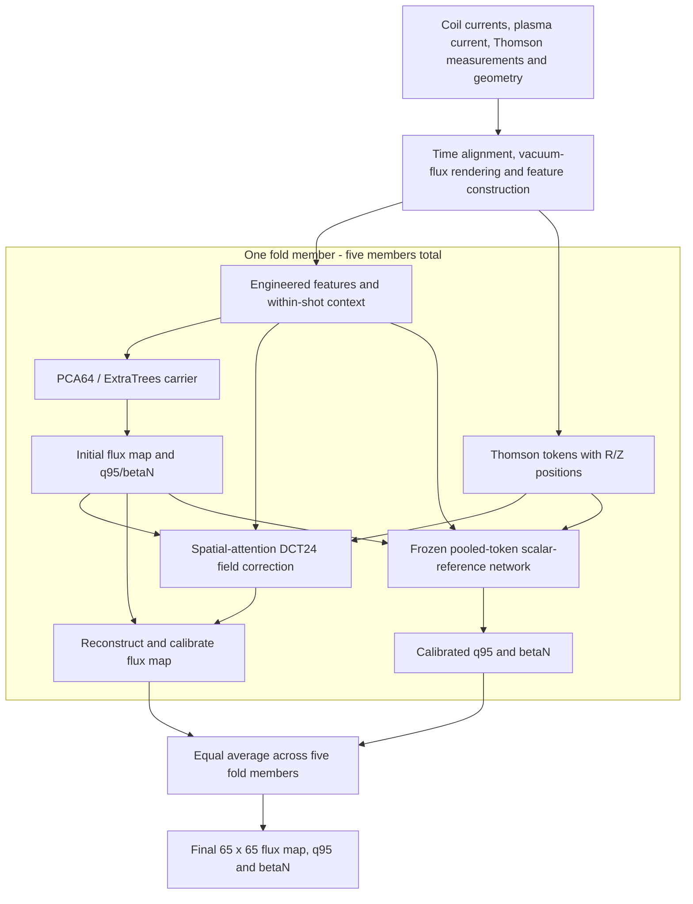

# Fusion Equilibrium Challenge (NeurIPS 2026): Challenge 1 submission reproducibility

This repository is the **submission reproducibility package for Challenge 1 of
the Fusion Equilibrium Challenge (NeurIPS 2026)**.

It trains, evaluates and runs the five-fold PCA/ExtraTrees + DCT24
spatial-attention model used for the historical **FEC1 public S = 0.9931** result.
Start with raw challenge data: **no pretrained weights, carriers, cached arrays,
previous artifacts, parent checkout or external research protocol is required.**
Every carrier, scalar-reference model and field-correction network is fitted by
the workflow below. Generated models stay in your local run directory.

## What is Challenge 1?

Challenge 1 reconstructs plasma equilibria on the **DIII-D tokamak**, learning
from labelled DIII-D discharges and predicting unseen discharges from the same
machine. Inputs include coil currents, plasma current, Thomson-scattering
electron temperature and density measurements, and machine geometry. Magnetic
probe and flux-loop measurements are unavailable. For each requested time, the
model predicts a **65 x 65 poloidal magnetic-flux map**, the edge safety factor
**q95**, and normalized plasma pressure **betaN**. See the
[official data description](https://fusion-equilibrium-challenge.sophelio.io/data/).

The composite score combines flux accuracy (55%), q95/betaN accuracy (15%),
plasma-boundary alignment (10%), and consistency of quantities derived from the
predicted flux map (20%). The scorer extracts the boundary, magnetic axis and
other geometric quantities from the map itself. See the
[official evaluation rules](https://fusion-equilibrium-challenge.sophelio.io/rules/).

## How the model works

The model averages **five fold members**, each combining a tree-based initial
prediction with a neural correction:

1. **Prepare the observations.** Align inputs to the requested times, render
   analytic vacuum flux from coil currents and geometry, and build engineered
   features with within-shot temporal context. Thomson measurements become up
   to 192 tokens carrying their values and R/Z positions.
2. **Predict an initial equilibrium.** Each member's carrier contains a PCA
   basis and three ExtraTrees regressors. They predict 64 normalized-flux PCA
   coefficients, the field's mean and log RMS, and initial q95/betaN values.
   Inverse PCA and the predicted mean/scale reconstruct the initial flux map.
3. **Correct the flux map.** A spatial-attention network combines the context,
   initial predictions and Thomson tokens. It predicts 575 nonconstant
   coefficients in a 24 x 24 discrete cosine transform (DCT) basis, plus
   mean/log-RMS corrections. These update the normalized field shape and its
   offset and scale. A separate pooled-token scalar-reference network supplies
   q95/betaN and remains frozen during this field-correction training.
4. **Calibrate and average.** Apply each member's selected correction strengths,
   then average its flux and scalar predictions with equal weights of 0.2.



Training uses nested splits by whole discharge: carrier predictions supplied
to correction-training rows exclude that discharge's targets. Inner selection
shots choose checkpoints and calibration; outer-fold shots provide held-out
evaluation. The training objectives combine field shape, gradients, offset/scale
and geometry terms. See [the full recipe](docs/REPRODUCTION.md) for the exact
settings and selection procedure.

## Compute requirements

Use Python 3.11 on Linux. The full recipe is substantial: the historical neural
fits used a V100S GPU and 96 GiB RAM. Plan for at least 300 GB of free disk space
for raw data, caches, intermediate arrays and generated models. Runtime depends
on your hardware; this is a five-fold ensemble with nested tree fits and ten
neural fits. CPU execution is supported, but the full fit will be slow.

## 1. Install and test

```bash
git clone https://github.com/glorenz1/fusion-equilibrium-challenge-2026.git
cd fusion-equilibrium-challenge-2026
python3.11 -m venv .venv
.venv/bin/python -m pip install -r requirements-dev.txt
.venv/bin/python -m pytest -q
```

For training/inference without development tests, install `requirements.txt`.
Use a PyTorch build appropriate for your GPU/driver; see the
[official installation instructions](https://pytorch.org/get-started/locally/).
The committed pins describe the checked Python environment, not a guarantee of
identical numerical results across CPU/GPU builds.

Exercise every stage on a tiny synthetic dataset first:

```bash
.venv/bin/python -m fec1 smoke --run runs/smoke --workers 1
```

This generates raw parquet inputs, prepares them, fits five carriers and all ten
neural models, evaluates held shots, predicts and independently rescores the
predictions. Its reduced models and synthetic scores are **software checks**.
They do not measure challenge performance. Run the automated fresh-checkout
integration test with `.venv/bin/python -m pytest -q -m integration`.

## 2. Obtain the training data

The official source is the
[Sophelio/fusion-equilibrium-challenge dataset on Hugging Face](https://huggingface.co/datasets/Sophelio/fusion-equilibrium-challenge).
Download the **7,041 labelled DIII-D training shots**:

```bash
.venv/bin/python -m fec1 download --output data --split diii_d_train --workers 4
```

The downloader pins dataset commit
`1e280905b85f2a6fdde7e06fca8cf3a1edf447cb`, verifies the official per-file SHA-256
hashes, and writes `data/diii_d_train/download.json`. Repeating it verifies and
skips existing files. No Hugging Face account or additional downloader package
is needed for this public release. See [docs/DATA.md](docs/DATA.md) for the
source, licence, layout, included input fixes and fixed local splits.

## 3. Prepare and train

Run from the repository root:

```bash
.venv/bin/python -m fec1 prepare \
  --data data/diii_d_train --run runs/main --workers 8
.venv/bin/python -m fec1 train \
  --run runs/main --device cuda --workers 8
```

Preparation builds the complete cache and supervision pipeline. Training fits
each nested carrier, its pooled scalar-reference network and its final spatial
field network in order. It requires only the prepared run. The full recipe and
stage settings are in [docs/REPRODUCTION.md](docs/REPRODUCTION.md).

Each run records data content hashes, the exact split, source/config identity,
package versions, commands and logs. `runs/main/model.json` identifies the ten
newly generated deployment files. Weights and carriers are written without
compression. Use the same command with `--resume` to skip completed stages;
failed attempts are preserved before their stage is restarted. Code/config or
raw-data changes require a new run. Avoid changing the implementation during a fit.

## 4. Evaluate and score locally

```bash
.venv/bin/python -m fec1 evaluate --run runs/main --device cuda --workers 4
.venv/bin/python -m fec1 score --run runs/main \
  --predictions runs/main/evaluation/development_predictions.npz \
  --output runs/main/development-score.json --workers 4
```

Evaluation pools one outer-fold prediction per training row, then evaluates the
fixed ensemble on all 689 development shots. Scoring independently loads the
development predictions and computes the exact local scorer's **S, R2_psi,
R2_qb, D_LCFS and consistency** terms. It rejects missing frames, incomplete
outputs, and training/frozen-audit shots. The 675 frozen-audit identities remain
excluded from training, checkpoint selection and the default reported metrics.
Use local held-shot metrics to assess your fit; do not tune against hidden labels.

## 5. Predict on public inputs

```bash
.venv/bin/python -m fec1 download --output data --split diii_d_public_test
.venv/bin/python -m fec1 predict --run runs/main \
  --inputs data/diii_d_public_test --output outputs/public \
  --device cuda --workers 4 --batch-size 128
```

The result is `outputs/public/diii_d_public_test.npz`, containing float32
`shot_NNNN_psirz`, `shot_NNNN_q95` and `shot_NNNN_betaN` arrays in sorted filename
order. All five trained members participate. The command verifies your generated
model manifest before loading it. Use `--device cpu` without a GPU and
`--max-shots 1` for a bounded prediction check.

Public test targets are withheld, so this repository cannot compute a public
leaderboard score locally. Follow the
[official submission instructions](https://github.com/Sophelio/fusion-equilibrium-challenge-starter#5-build-and-submit)
if you want organizer scoring. This repository covers DIII-D Challenge 1.

The historical public **0.9931**, development **0.993469**, and pooled outer-OOF
**0.990843** scores describe different populations. A fresh fit reports its own
metrics; neither the exact old weights nor the public score is guaranteed.
Historical provenance remains in `repro/`; see [docs/VALIDATION.md](docs/VALIDATION.md)
for executed checks and [docs/LAYOUT.md](docs/LAYOUT.md) for the package layout.
