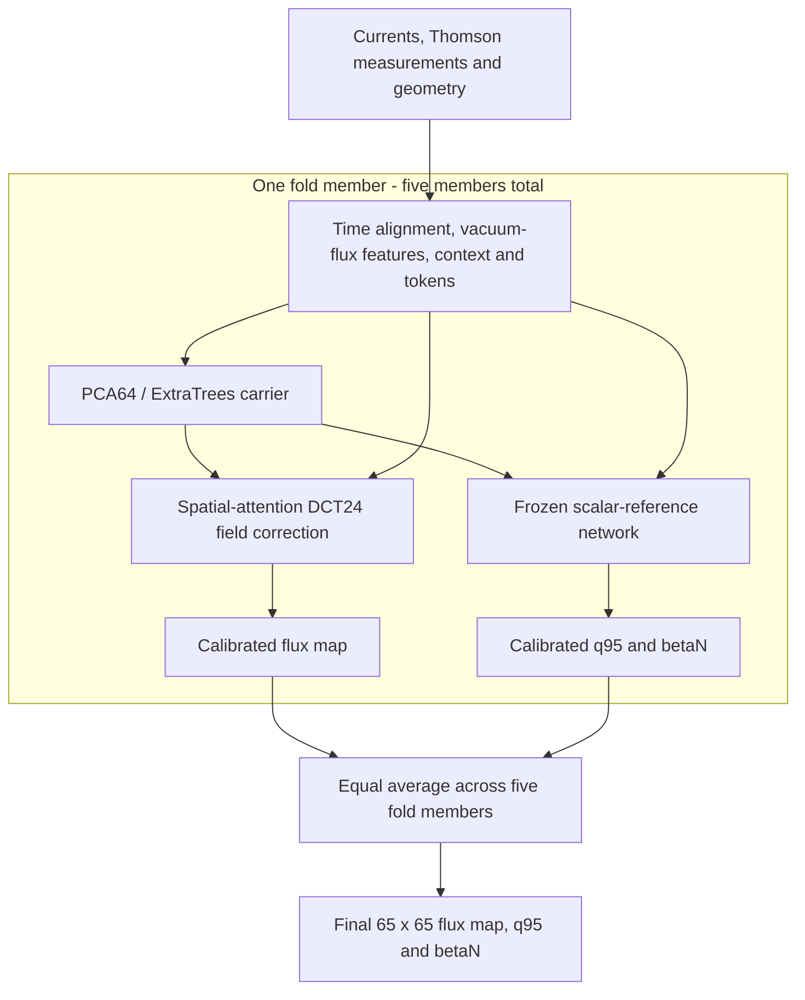

# Fusion Equilibrium Challenge (NeurIPS 2026): Challenge 1 submission reproducibility

This is the **submission reproducibility package for Challenge 1** of the
Fusion Equilibrium Challenge (NeurIPS 2026). It rebuilds the PCA/ExtraTrees +
DCT24 spatial-attention ensemble behind the historical **public S = 0.9931**
result, starting from raw data. No pretrained weights or carriers are required.

## What is Challenge 1?

Reconstruct plasma equilibria for unseen **DIII-D tokamak discharges** using
coil and plasma currents, Thomson-scattering temperature/density measurements,
and machine geometry, without magnetic probe or flux-loop measurements. Outputs
are a **65 x 65 poloidal flux map**, edge safety factor **q95**, and normalized
plasma pressure **betaN** at each requested time.

Scoring combines flux accuracy (55%), q95/betaN accuracy (15%), boundary alignment
(10%), and flux-derived consistency (20%). See the official
[data description](https://fusion-equilibrium-challenge.sophelio.io/data/) and
[evaluation rules](https://fusion-equilibrium-challenge.sophelio.io/rules/).

## How the model works

The ensemble averages five members trained on different shot folds. Inputs are
aligned in time and converted to vacuum-flux features, temporal context and
Thomson measurement tokens with spatial coordinates. Each member then:

1. Uses a **PCA64/ExtraTrees carrier** to predict an initial flux map and scalars.
2. Applies a **spatial-attention network** that corrects the field's shape using
   a 24 x 24 discrete cosine transform (DCT) basis, plus its offset and scale.
   A separate scalar-reference network supplies q95/betaN and stays frozen
   during field training.
3. Calibrates its corrections before the five members are averaged equally.



Nested splits keep whole discharges separate: correction training uses carrier
predictions made without that discharge's targets. Inner shots select checkpoints
and calibration; outer shots provide held-out evaluation. Exact architecture,
losses and settings are in [the training recipe](docs/REPRODUCTION.md).

## Compute requirements

Use **Python 3.11 on Linux** and plan for **300 GB of free disk space**.
Historical neural fits used a V100S GPU and 96 GiB RAM. CPU execution is supported
but slow; see the [cluster instructions](docs/REPRODUCTION.md#running-on-a-cluster).

## 1. Install and test

```bash
git clone https://github.com/glorenz1/fusion-equilibrium-challenge-2026.git
cd fusion-equilibrium-challenge-2026
python3.11 -m venv .venv
.venv/bin/python -m pip install -r requirements-dev.txt
.venv/bin/python -m pytest -q
```

Use a PyTorch build appropriate for your GPU/driver; see its
[installation instructions](https://pytorch.org/get-started/locally/).
Exercise every stage on a tiny synthetic dataset first:

```bash
.venv/bin/python -m fec1 smoke --run runs/smoke --workers 1
```

This checks the complete workflow with small models. Its synthetic scores do
not measure challenge performance. More checks are in [docs/VALIDATION.md](docs/VALIDATION.md).

## 2. Obtain the training data

Download the **7,041 labelled DIII-D training shots** from the
[official dataset](https://huggingface.co/datasets/Sophelio/fusion-equilibrium-challenge):

```bash
.venv/bin/python -m fec1 download --output data --split diii_d_train --workers 4
```

The downloader pins the release, verifies SHA-256 hashes and skips verified
existing files. No Hugging Face account is needed. See [docs/DATA.md](docs/DATA.md)
for the revision, licence and fixed splits.

## 3. Prepare and train

Run from the repository root:

```bash
.venv/bin/python -m fec1 prepare \
  --data data/diii_d_train --run runs/main --workers 8
.venv/bin/python -m fec1 train \
  --run runs/main --device cuda --workers 8
```

All generated models, caches and provenance records stay under `runs/main/`.
Weights and carriers are uncompressed. Add `--resume` to preparation or training
to skip completed stages; code, config or raw-data changes require a new run.

## 4. Evaluate and score locally

```bash
.venv/bin/python -m fec1 evaluate --run runs/main --device cuda --workers 4
.venv/bin/python -m fec1 score --run runs/main \
  --predictions runs/main/evaluation/development_predictions.npz \
  --output runs/main/development-score.json --workers 4
```

Evaluation reports pooled outer-fold metrics and the ensemble's score on
**689 development shots**. The second command independently rescores its saved
development predictions. Results include **S, R2_psi, R2_qb, D_LCFS and consistency**.
The 675 frozen-audit shots remain excluded.

## 5. Predict on public inputs

```bash
.venv/bin/python -m fec1 download --output data --split diii_d_public_test
.venv/bin/python -m fec1 predict --run runs/main \
  --inputs data/diii_d_public_test --output outputs/public \
  --device cuda --workers 4 --batch-size 128
```

Predictions are written to `outputs/public/diii_d_public_test.npz` in the
challenge format. Use `--device cpu` without a GPU or `--max-shots 1` for a
single-shot check.

Public test targets are withheld, so this repository cannot compute a public
leaderboard score locally. Follow the
[official submission instructions](https://github.com/Sophelio/fusion-equilibrium-challenge-starter#5-build-and-submit)
for organizer scoring.

## Reproduction status

The complete workflow has passed synthetic integration tests, and the original
weights passed a prediction-parity check. A full real-data retraining has not
yet been verified; a fresh fit is not guaranteed to reproduce the exact weights
or historical public score. See [validation evidence](docs/VALIDATION.md),
[historical records](repro/) and [repository layout](docs/LAYOUT.md).
